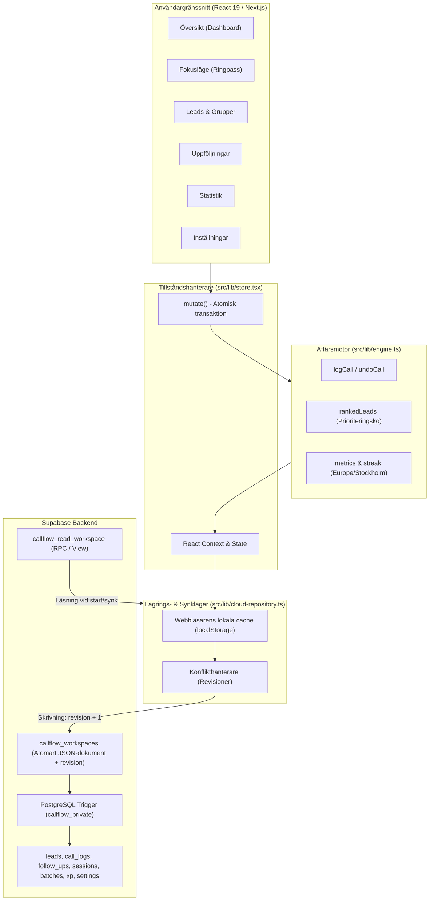

# Systemarkitektur & Datamodell

CALLFLOW är ett skräddarsytt, prestandaoptimerat CRM för svensk soloförsäljning och mötesbokning. Systemet är byggt för maximal hastighet i ringpassen och kombinerar **lokal offline-funktionalitet** med **molnsynkronisering i Supabase** och en **relationell databasprojektion**.

---

## 1. Teknologistack

| Område | Teknik | Motivering & Roll |
| :--- | :--- | :--- |
| **Ramverk** | Next.js 16 (App Router) | Snabb routing, statisk optimering, säker produktion |
| **Klientbibliotek** | React 19 & TypeScript 5.9 | Strikt typad arkitektur med modern state-hantering (`useDeferredValue`, `Suspense`) |
| **Stil & Layout** | Tailwind CSS v4 & Vanilla CSS | Blixtsnabb CSS med skräddarsydda designvariabler för mörkt/ljust läge |
| **Komponenter & UI** | Radix UI, Lucide Icons, Motion | Tillgängliga dialoger, intuitiva ikoner och mjuka mikroanimationer |
| **Datavisualisering** | Recharts | Responsiva diagram för dagliga och veckovisa samtalsmål |
| **Datavalidering** | Zod 4 | Strikt runtime-validering av all data och importer |
| **Filhantering** | PapaParse, ExcelJS, Web Workers | Bakgrundsbearbetning av CSV och Excel (XLSX) utan att blockera UI |
| **Databas & Auth** | Supabase (PostgreSQL 15+) | Lösenordsautentisering, RLS (Row Level Security) och atomär synkronisering |
| **Testning** | Vitest & Playwright | Snabb enhetstestning av affärsmotorn samt kompletta E2E-användarresor |

---

## 2. Högnivåarkitektur & Dataflöde

CALLFLOW använder ett **enhets- och tillståndscentrerat flöde** (Single Source of Truth) där all affärslogik är samlad i funktionella motorer (`engine.ts`, `organization.ts`, `import.ts`) som tar ett tillstånd och returnerar ett nytt utan bieffekter.



---

## 3. Datamodell & Scheman

Huvudobjektet `Data` representerar hela användarens arbetsrum. Det är strikt versionerat (`version: 1`) och valideras med Zod i `src/lib/repository.ts`.

### Typdefinitioner (`src/lib/model.ts`)

```typescript
export interface Data {
  version: 1;
  leads: Lead[];
  calls: CallLog[];
  followUps: FollowUp[];
  sessions: CallingSession[];
  batches: ImportBatch[];
  xp: XPEvent[];
  settings: GoalSettings;
  groups: LeadGroup[];
}
```

### Entiteter i detalj

1. **`Lead`**:
   - `id`: UUID.
   - `companyName`: Företagsnamn (1–300 tecken).
   - `phone`: Råtelefonsträng samt `normalizedPhone` (normaliserat med svenskt prefix `+46`).
   - `website`: URL samt `normalizedDomain` (gemener utan `www.`).
   - `industry`, `city`, `contactName`, `notes`: Valfria metadatafält.
   - `status`: En av sju definierade statusar:
     - `Ej kontaktad` (standard vid import)
     - `Inget svar`
     - `Återkom senare`
     - `Intresserad`
     - `Möte bokat`
     - `Inte intresserad`
     - `Kund`
   - `source`: Leadets ursprung (t.ex. *Google Maps*, *Instagram*, *LinkedIn*, *Manuellt*).
   - `groupId`: Valfri referens till en `LeadGroup`.
   - `lastContactedAt`, `nextFollowUpAt`: Tidsstämplar (ISO 8601).

2. **`CallLog`**:
   - `id`: Idempotent händelse-ID.
   - `leadId`: Företags-ID.
   - `sessionId`: Koppling till specifikt ringpass.
   - `outcome`: Registrerat samtalsutfall (`Status`).
   - `notes`: Anteckning vid samtalstillfället.
   - `meetingAt`: Tidsstämpel om möte bokades.
   - `createdAt`: ISO-tidsstämpel.

3. **`FollowUp`**:
   - `id`: Unikt ID.
   - `leadId`: Företags-ID.
   - `dueAt`: Förfallotidpunkt (beräknad i svensk tidszon).
   - `status`: `pending` eller `completed`.
   - `completedAt`: Tidpunkt då uppföljningen slutfördes.
   - `sourceCallId`: Samtalet som skapade uppföljningen.

4. **`CallingSession`**:
   - `id`: Unikt ID för ringpasset.
   - `startedAt`, `endedAt`, `activeSince`: Tidsstämplar för passet.
   - `activeDuration`: Ackumulerad aktiv samtalstid i sekunder (exklusive paustid).
   - `status`: `active`, `paused` eller `ended`.
   - `selectedBatch`: Filtrerat import-batch eller `all`.
   - `includedStatuses`: Valda statusar som ingår i köurvalet.
   - `visited`: Lista över företags-ID:n som redan passerats under passet.

5. **`LeadGroup`**:
   - `id`: Unikt grupp-ID.
   - `name`: Gruppnamn (upp till 80 tecken).
   - `color`: En av 6 utvalda accentfärger.

6. **`XPEvent`**:
   - `id`: Händelse-ID.
   - `sourceEventId`: ID för samtalet eller uppföljningen som genererade poängen.
   - `type`: `call` (+5p), `followup` (+10p), `meeting` (+30p), `customer` (+100p).
   - `points`: Antal intjänade poäng.

7. **`GoalSettings`**:
   - `dailyCallTarget` (standard 50)
   - `weeklyCallTarget` (standard 250)
   - `weeklyMeetingTarget` (standard 5)
   - `weeklyFollowUpTarget` (standard 20)
   - `weeklyCustomerTarget` (standard 2)
   - `preferredWorkingDays` (standard `[1, 2, 3, 4, 5]`, dvs. måndag–fredag)
   - `theme`: `light` | `dark` | `system`

---

## 4. Synkronisering & Offline-motor

CALLFLOW är konstruerat enligt principen **Local-First with Cloud Persistence**:

1. **Direkt respons**: Varje användarinteraktion uppdaterar det lokala tillståndet och webbläsarens cache omedelbart.
2. **Köad bakgrundssynk**: Ändringar skickas till Supabase i bakgrunden. Om flera ändringar görs snabbt (t.ex. under ett intensivt ringpass) serialiseras och köas anropen så att inga uppdateringar försvinner.
3. **Revisionskontroll & Konflikthantering**:
   - Varje sparande i molnet kräver att klientens `revision` matchar databasens aktuella `revision`.
   - Om en annan enhet har sparat under tiden kastas ett `ConflictError`.
   - Vid konflikt behålls både den lokala versionen och molnversionen. Användaren kan välja vilken som ska gälla i Inställningar utan risk för dataförlust.
4. **Nätverksbortfall**:
   - Om anslutningen bryts ändras statusen till `offline`.
   - Ändringar ligger kvar i den lokala cachen (`callflow.cloud.<project_ref>.<owner_id>`).
   - När nätverket återvänder eller användaren klickar på *Försök igen* synkroniseras ändringarna automatiskt.

---

## 5. Databasarkitektur i Supabase

Systemet använder en avancerad tvåstegsmodell i PostgreSQL:

### Atomärt skrivdokument (`callflow_workspaces`)
Klienten skriver hela det validerade JSON-dokumentet till tabellen `callflow_workspaces`:
```sql
create table public.callflow_workspaces (
  owner_id uuid primary key references auth.users(id),
  revision bigint not null,
  document jsonb not null,
  updated_at timestamptz not null default now()
);
```

### Automatisk Relationell Projektion
En privat PostgreSQL-trigger (`callflow_private.sync_workspace_tables()`) körs i **samma databastransaktion**. Den packar upp JSON-dokumentet till riktiga SQL-tabeller:
- `public.leads`
- `public.call_logs`
- `public.follow_ups`
- `public.calling_sessions`
- `public.import_batches`
- `public.xp_events`
- `public.goal_settings`

Om något fält bryter mot databasens integritetsregler rullas hela transaktionen tillbaka.

### Läsning via `callflow_read_workspace`
När appen startar anropas funktionen `callflow_read_workspace` med `SECURITY INVOKER`. Den rekonstruerar arbetsytan från de relationella tabellerna och verifierar användarens RLS.

---

## 6. Säkerhetsmodell & RLS (Row Level Security)

- **Single Owner Policy**: CALLFLOW är optimerat för soloföretagaren. Tabellen `callflow_access` definierar exakt vilken e-postadress som har behörighet:
  ```sql
  create table public.callflow_access (
    email text primary key
  );
  ```
- **RLS på alla tabeller**: Samtliga tabeller har RLS aktiverat. Endast den inloggade användaren vars `auth.uid()` matchar `owner_id` och vars e-post finns i `callflow_access` har läsrättigheter.
- **Skrivskydd för klienten på entitetstabeller**: Klienten har endast rätt att läsa de relationella tabellerna. Direkta SQL-inserts/updates på `public.leads` eller `public.call_logs` från klienten är spärrade; all uppdatering måste gå via det validerade arbetsrummet för att förhindra inkonsistens mellan loggar, status och XP.

## Smarta arbetsflöden (valfria fält i version 1)

`Lead` kan också innehålla `nextRetryAt`, `nextStep` (`kind`, `dueAt`, `note`), `alternatePhones`, `alternateWebsites`, `alternateNames` och `mergedFrom`. `CallLog.direction` skiljer inkommande och utgående samtal; äldre loggar saknar fältet. `FollowUp.resolution` skiljer verkligt utförda uppföljningar från ersatta eller stängda löften, så att omplanering inte räknas som utförd uppföljning.

Fälten valideras i `repository.ts` och följer med i det befintliga JSON-dokumentet. Databasprojektionen bevarar hela `data` för varje entitet och läser tillbaka detta JSON, därför krävs ingen SQL-migrering för de nya fälten. Äldre säkerhetskopior utan fälten kan fortfarande läsas.

Återförsök och prioriterade åtgärder beräknas i `lead-intelligence.ts`; dubblettgranskning och atomär sammanslagning i `duplicates.ts`. En sammanslagning flyttar referenser i samtal, uppföljningar och ringpass till huvudposten och ändrar inte händelse-ID:n eller XP. Inkommande samtal använder samma transaktionsmotor som fokus, men utan ett ringpass-ID, så att kön för det pågående passet inte flyttas.
